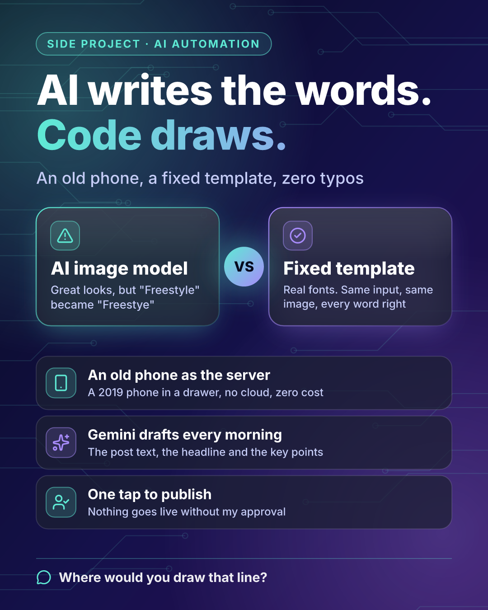

# SAP LinkedIn Auto-Poster

A personal bot that wrote one SAP-technical LinkedIn post every morning, sent it to me on Telegram for review, and published it to my LinkedIn profile only after I tapped ✅ Post. It ran on an old Android phone at home and cost nothing to run.

> **Retired on 18 Nov 2026.** The proof of concept did what it set out to do, so the bot was switched off, and the Telegram bot, the LinkedIn app and their tokens were deleted (see [How it was shut down](#how-it-was-shut-down)). The code stays here for reference. To run it, you need your own keys.

<p align="center">
  
  &nbsp;
  
</p>
<p align="center"><sub>Left: the project in one picture, drawn by the bot's own template. Right: an image the bot drew for a real daily draft, with the text Gemini wrote for it.</sub></p>

## At a glance

| | |
|---|---|
| **What** | One SAP post per day (ABAP, CAP, Fiori, BTP, S/4HANA and more), with an infographic image |
| **Who decides** | A human. Nothing reached LinkedIn without an explicit tap on that exact draft |
| **Text** | Google Gemini API, free tier: one call per draft returns the post and the image text as JSON |
| **Image** | Drawn by the bot from a fixed template with real fonts, so every word is spelled right. No AI image model |
| **Approval** | A private Telegram bot with ✅ Post / ⏭ Skip / 🔄 Regenerate buttons |
| **Publishing** | LinkedIn's official Posts and Images APIs |
| **Host** | A 2019 Samsung Galaxy M30 (Android 10) running Node.js in Termux. First rehearsed on a laptop |
| **Running cost** | ₹0: free API tiers and hardware I already owned |
| **Built and run** | 4 to 18 Nov 2026 |

## Results

- **Posted every day for 11–12 days, with one tap each.** The draft and its image were waiting in Telegram at 09:00 IST. My part shrank to reading it and tapping Post.
- **No post went out unreviewed, and none went out twice.** Every post carried an AI disclaimer line: *🤖 AI Generated Content, curated by a human. Spot something off? Tell me in the comments 👇*
- **Every word on the images appeared exactly as written.** Before the template, free AI image models were tested, and they left spelling mistakes in every image.
- **My LinkedIn credentials never left my own devices.** The app never saw my password, and the access token lived only in a local file. The bot had no public address and no cloud account.
- **Zero running cost**, on a phone that had been sitting in a drawer.

## Why build it

- **Consistency without the daily blank page.** A topic bank and a fixed send time meant a solid draft every morning, so the human time went into judging the content, not producing it.
- **Human in the loop, by design.** Automation that posts under your real name has to be easy to stop and impossible to misfire. The approval tap was the core feature, not an add-on.
- **Learn the official APIs end to end.** LinkedIn OAuth and posting, the Telegram Bot API and structured LLM output, without scraping or browser automation.
- **Prove that small, private automation can run for free** on hardware you already own.

## How it worked

```
   Laptop first, then a Samsung Galaxy M30 · Node.js · one process (npm start)
 ┌────────────────────────────────────────────────────────────────────┐
 │ timer (30s) ─► is a daily draft due? ─► createDraft ─► Gemini (JSON) │
 │                                              │                     │
 │ long polling ◄─► Telegram Bot API            ▼                     │
 │   (getUpdates)    commands, taps,    data/state.json               │
 │                   images             (drafts, offset, LinkedIn token)│
 │ serial queue: every state change runs one at a time                 │
 │ publisher: dry run (DRY_RUN on) → LinkedIn API (DRY_RUN=false)      │
 └────────────────────────────────────────────────────────────────────┘
 All connections are outbound. Nothing listens on the internet.
```

### A normal day

1. **09:00 IST:** a timer that checks every 30 seconds sees the day's draft is due. If the device was asleep, it catches up until 12:00. It is a polled check, not a cron job, so a reboot or a sleeping laptop doesn't lose the day.
2. **Topic:** the date picks one of 75 topics (15 categories × 5 subtopics) and one of 8 post formats. No history is needed, and nothing repeats within 75 days.
3. **Gemini** gets the topic plus the writing rules and returns structured JSON: hook, text, hashtags, an image prompt, and the infographic text. The bot validates it locally (lengths, hashtag count, emoji count, a warning on any `%`). It never retries on its own, to protect the free quota. A failure shows a **Try again** button instead.
4. **The bot draws the image** (below) and sends two Telegram messages: the post, then the image with the buttons.
5. **I decide.** ✅ Post publishes. ⏭ Skip ends the day. 🔄 Regenerate writes the same topic from a different angle. Sending my own image replaces the drawn one.
6. **Publishing:** the bot downloads the image from Telegram, uploads it to LinkedIn, creates the post and replies with the link.

### The parts worth reusing

- **AI writes the words, code draws.** Gemini writes short image text (label, headline, subtitle, 3–4 takeaways with icon names, a closing question) in the same call as the post. `src/image/` builds an SVG from a template with three layouts (compare, code, list), measures every line with real font metrics (`opentype.js`), and renders a 1080×1350 PNG with `@resvg/resvg-wasm`. It uses bundled fonts (Inter, JetBrains Mono), 53 Lucide icons and five colour themes rotating by day. The same input always gives the same image. Text that doesn't fit throws an error rather than being cut off, and any failure falls back to sending the image idea, so a draft is never blocked. Pure JavaScript and WASM, so it runs the same on Windows and Android.
- **No public URL at all.** Telegram is read by long polling (`getUpdates`), so the phone needs no webhook, tunnel or domain. For LinkedIn sign-in, the redirect goes to `http://localhost:8765/...` on the device itself. When the link is opened on another device, I paste the browser's address into Telegram, and the bot finishes the sign-in and deletes that message. The short-lived sign-in code may pass through Telegram; the access token never does.
- **A draft lifecycle that can't double-post.** Each draft moves through `GENERATED → SENT → POSTING → POSTED`, or to `SKIPPED` / `EXPIRED`. The status becomes `POSTING` before any API call, and every button re-checks it, so an old button can't post a stale draft. If the result is unclear (a timeout or a 5xx after the request went out), the draft becomes `UNKNOWN` and the bot asks: *It's on LinkedIn* or *Not there*. It never guesses and retries.
- **Owner lock.** The bot obeys one Telegram chat id and ignores everyone else.
- **One process, one JSON file.** State lives in `data/state.json` with atomic writes. A serial queue runs every state change one at a time. No database, no framework.
- **Secrets stay out of git.** `.env` and `data/state.json` are gitignored, and a pre-commit hook (`.githooks/` + `src/cli/checkSecrets.js`) blocks secret files, the machine's real key values and key-shaped strings.

### Running on an old phone

The bot ran as a `termux-services` service on the Galaxy M30, restarting on crash, with Termux:Boot starting it after a reboot (`deploy/termux/`). The code came from this repo with `git pull`. The `.env` file reached the phone as a QR code shown on the laptop screen, so no key went through a network or a cloud service.

## Lessons learned

1. **Free AI image models can't spell.** FLUX.2 klein and Leonardo Phoenix (Cloudflare Workers AI, free tier) were tested on a real draft. Klein's layouts looked good, but every image had 2–4 spelling mistakes ("Freestye", "Maintenance Maintenante"); Phoenix garbled its headline. A wrong word under your own name is worse than a plain image, so the bot draws the text itself.
2. **LLMs invent numbers.** The first Gemini draft claimed "80% of apps". The prompt now forbids undocumented figures, and the validator flags any `%`. Accuracy rules matter more than style rules when posts go out under a real name.
3. **LinkedIn silently truncates unescaped text.** Post text uses LinkedIn's "little text" format, where `\ | { } @ [ ] ( ) < > # * _ ~` must be backslash-escaped. Otherwise the post is cut off without an error (`src/linkedin/littleText.js`).
4. **Self-serve LinkedIn tokens last 60 days with no refresh token.** The bot reminds you in the last week, and reconnecting is one tap while you're still logged in.
5. **Android sleeps unless told not to.** The first phone draft came 5 minutes late, and only after I messaged the bot. Typing `exit` in Termux had dropped its wake lock, so the 30-second timer stalled. Fix: keep the wake lock and never exit Termux.
6. **A 1.7B on-device model isn't enough for expert content.** As an experiment, the same prompt and JSON schema went to Qwen3 1.7B on the phone via llama.cpp (`draft --local`). It produced valid JSON in about 6 minutes, fast enough for a morning job. But it called VALUE, CORRESPONDING and SWITCH "traditional methods" when they *are* ABAP constructor operators. Gemini stayed.
7. **Node's `fetch` gives up after 300 seconds without response headers.** A slow, non-streamed local model reply hit that limit, and streaming the response fixed it.

## What's in the repo

| Path | Contents |
|---|---|
| `src/app.js` | Wiring, startup checks, timer and polling |
| `src/bot/` | Telegram commands, buttons, messages, daily timer, polling loop |
| `src/generation/` | Prompts, JSON schema and validation, Gemini provider, local-LLM and mock providers |
| `src/image/` | Infographic template, renderer, icons, bundled fonts |
| `src/linkedin/`, `src/publish/` | OAuth, callback server, API client, little-text escaping, publisher, dry-run publisher |
| `src/store/`, `src/topics/` | JSON state with atomic writes, serial queue, topic rotation |
| `prompts/` | The writing rules given to Gemini |
| `data/topics.json` | The 75 topics and 8 formats |
| `deploy/termux/` | Phone setup, update, boot and local-model test scripts |
| `tests/` | 108 `node:test` tests; every external API is faked, nothing is sent |
| `CLAUDE.md` | The full decision log and status record, kept while building it with Claude Code |
| `MAINTENANCE.md` | What expired and when, for a running copy |
| `assets/sap-auto-poster-architecture.pdf` | System map, daily sequence, draft lifecycle and where the secrets lived, as of 4 Nov 2026 (before the bot drew its own images and moved to the phone) |

## Running it yourself

Treat this as a reference, not a maintained product. It needs Node.js 22 or newer, plus your own:

1. **Telegram bot:** create one with @BotFather, press Start in it, then `npm run telegram:setup` shows your chat id.
2. **Gemini API key:** from Google AI Studio (free tier). Run `npm run models` and pick a current model; the `gemini-3-flash-preview` used here may be gone.
3. **LinkedIn developer app:** it must be linked to a LinkedIn Page (a placeholder Page is fine). Add the products **Share on LinkedIn** and **Sign In with LinkedIn using OpenID Connect**, and the redirect URL `http://localhost:8765/auth/linkedin/callback`.

```
npm ci
copy .env.example .env        (cp on Linux/Termux), then fill in the keys
git config core.hooksPath .githooks
npm test
npm start                      then /linkedin in Telegram to connect LinkedIn
```

`DRY_RUN` is on unless it is exactly `false`, so nothing is posted until you choose to. LinkedIn supports API version `202610` for at least a year from October 2026; after that, set `LINKEDIN_API_VERSION` to a newer one.

| Command | What it does |
| --- | --- |
| `npm start` | Runs the bot: Telegram and the daily timer. Add `-- --mock` for offline drafts |
| `npm test` | Runs the tests; every external API is faked, nothing is sent |
| `npm run draft` | Writes one draft to the terminal only. Add `-- --image preview.png` to draw its image too |
| `npm run models` | Lists the Gemini models your key can use |
| `npm run telegram:setup` | Checks the bot token and shows your chat id |
| `npm run phone:bundle` | Packs the bot for a phone (`-- --with-secrets` for a first install) |
| `npm run secrets:check -- --all` | Confirms no key or token is in any file git would upload |

In Telegram: `/draft`, `/draft YYYY-MM-DD`, `/status`, `/linkedin`, `/help`.

## How it was shut down

Retiring an automation that holds your credentials is part of the job, so on 18 Nov 2026:

- **Phone:** the service, its logs, the boot script and the code folder were removed. Termux stays for other projects.
- **LinkedIn:** the app's access was removed under Settings → Data privacy → Permitted services (this cancels every token at once). The developer app was deleted, and the placeholder Page deactivated. The published posts stay on my profile.
- **Telegram:** the bot was deleted in @BotFather, which also cancels its token.
- **Leftovers:** the Cloudflare token from the image-model test was deleted, and the local `.env` and `state.json` copies removed.

Nothing in this repo was ever a working secret: the keys lived only in `.env` and `data/state.json`, which git never saw.

## Third-party assets

`src/image/fonts/` contains Inter and JetBrains Mono (SIL Open Font License 1.1; licence texts alongside). `src/image/icons.js` contains icon shapes from Lucide (ISC licence, quoted in the file). SAP, LinkedIn, Telegram and Gemini are trademarks of their owners. This project is not affiliated with any of them, and the images never used their logos.
